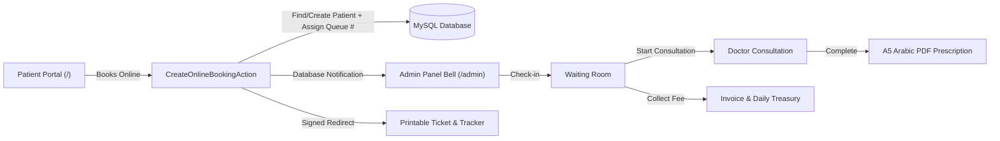

<div align="center">

# Dr.Code — Clinic Management & Online Booking System
### نظام إدارة العيادات الطبية والحجز الإلكتروني

A modern, full-stack clinic management system and Arabic RTL patient booking portal built with **Laravel 13**, **Filament 5**, **Tailwind CSS 4**, and **Pest 5**.

<p>
  
  
  
  
  
  
</p>

[Overview](#-overview) •
[Features](#-key-features) •
[Workflow](#-end-to-end-workflow) •
[Tech Stack](#-tech-stack) •
[Installation](#-installation--setup) •
[Testing](#-testing--code-quality)

</div>

---

## Overview

**Dr.Code** bridges the gap between patients and clinic administration in one unified platform:

1. **Patients** book appointments online in seconds, receive an instant queue number (`#queue_number`) and medical file code (`PAT-YYYY-XXXX`), print their booking ticket, and track or cancel their visit online.
2. **Clinic Reception & Doctors** receive real-time in-panel notifications for every new online booking or cancellation, manage the daily queue from check-in to consultation, collect fees with invoices, and print Arabic A5 PDF prescriptions.

---

## Key Features

### Patient Portal (Arabic RTL)
- **Instant Online Booking (`/`)**: Clean booking form with visit type selection (`كشف جديد`, `إعادة / متابعة`, `استشارة`), transparent fees, date validation, and optional complaint/notes.
- **Smart Patient Matching**: Automatically links returning patients by normalized phone number or creates a new patient record with an auto-generated sequential code (`PAT-2026-0001`).
- **Duplicate Booking Protection**: Prevents double-booking an active appointment for the same patient on the same date.
- **Signed Confirmation Ticket (`/appointments/confirmation/{appointment}`)**: Cryptographically signed confirmation page with queue number, patient code, visit details, and print-friendly layout (`window.print()`).
- **Booking Tracker & Self-Cancellation (`/appointments/track`)**: Patients can look up their bookings by phone number or patient code, monitor live status, and cancel `Booked` appointments via signed URLs.

### Clinic Administration (Filament 5 Panel — `/admin`)
- **Real-Time Database Notifications**: Admins receive instant notifications (with 30s polling and unread badge) whenever a patient books or cancels online, complete with a direct link to the appointment record.
- **Appointments & Queue Management**:
  - Dedicated Filament tabs: **الكل (All)**, **مواعيد اليوم (Today)**, **الحجوزات الإلكترونية (Online)**, and **القادمة (Upcoming)**.
  - Sidebar badge displaying upcoming booked appointments.
  - One-click workflow actions: **Check-in (`تسجيل وصول`)**, **Start Consultation (`بدء الكشف`)**, **Collect Fee (`تحصيل الرسوم`)**, and **Cancel (`إلغاء`)**.
  - Concurrency-safe daily queue numbering using database transactions and row locking (`lockForUpdate`).
- **Electronic Medical Records (EMR)**: Full patient profiles (`code`, `phone`, `national_id`, `birth_date`, `gender`, `blood_group`, `medical_history`, `notes`).
- **Consultations & Prescriptions**: Record vitals, chief complaint, diagnosis, internal notes, general advice, and structured prescription items linked to a seeded medicine catalog.
- **Arabic A5 PDF Prescriptions**: One-click printable A5 medical prescriptions rendered with full Arabic RTL text shaping via `mPDF`.
- **Treasury & Invoicing**: Collect appointment fees (Cash / Electronic payment methods), auto-generate invoices, and monitor daily cash vs. electronic revenue and queue stats on the dashboard (`ClinicStatsOverview`).

---

## End-to-End Workflow



---

## Tech Stack

| Layer | Technology |
| :--- | :--- |
| **Backend** | Laravel 13, PHP 8.4 |
| **Admin Panel** | Filament 5 (`auth:admin` guard, Cairo font, Teal/Slate theme) |
| **Frontend** | Blade, Tailwind CSS 4, Vite 8 |
| **Database** | MySQL (with isolated test database for Pest) |
| **PDF Generation** | `carlos-meneses/laravel-mpdf` (Arabic A5 prescriptions) |
| **Testing & Style** | Pest 5, Laravel Pint |

---

## Architecture Highlights

The business logic is cleanly encapsulated into single-responsibility **Action classes** and strongly typed **Backed Enums**:

```text
app/
├── Actions/
│   ├── BookAppointmentAction.php       # Concurrency-safe queue numbering & appointment creation
│   ├── CreateOnlineBookingAction.php   # Patient matching, duplicate prevention & admin notifications
│   ├── GeneratePatientCodeAction.php   # Sequential PAT-YYYY-XXXX patient code generator
│   ├── CheckInPatientAction.php        # Transition appointment from Booked -> Waiting
│   ├── StartConsultationAction.php     # Transition to InConsultation & initialize Consultation
│   ├── CompleteConsultationAction.php  # Save diagnosis, prescription items & mark Completed
│   └── CollectAppointmentFeeAction.php # Issue invoice & mark appointment paid
├── Enums/
│   ├── AppointmentSource.php           # reception | online
│   ├── AppointmentStatus.php           # booked | waiting | in_consultation | completed | cancelled | no_show
│   ├── AppointmentType.php             # examination | follow_up | consultation (with default fees)
│   ├── BloodGroup.php                  # A+, A-, B+, B-, AB+, AB-, O+, O-
│   ├── Gender.php                      # male | female
│   └── PaymentMethod.php               # cash | electronic methods
├── Filament/
│   ├── Resources/                      # Patients, Appointments, Consultations, Invoices, Medicines
│   └── Widgets/
│       └── ClinicStatsOverview.php     # Daily treasury, online bookings, waiting & completed counts
└── Http/
    ├── Controllers/
    │   ├── OnlineBookingController.php
    │   └── PrintPrescriptionController.php
    └── Requests/
        └── StoreOnlineBookingRequest.php
```

---

## Routes Overview

| Method | URI | Name / Access | Description |
| :--- | :--- | :--- | :--- |
| `GET` | `/` | `home` (Public) | Patient online booking portal |
| `POST` | `/appointments/book` | `appointments.book` (Throttled) | Submit a new online booking |
| `GET` | `/appointments/confirmation/{appointment}` | `appointments.confirmation` (Signed) | View & print booking confirmation ticket |
| `GET` | `/appointments/track` | `appointments.track` (Public) | Track appointments by phone or patient code |
| `POST` | `/appointments/{appointment}/cancel` | `appointments.cancel` (Signed) | Cancel a booked appointment & notify admins |
| `GET` | `/admin` | Filament Panel (`auth:admin`) | Clinic administration dashboard |
| `GET` | `/prescriptions/{prescription}/print` | `prescriptions.print` (`auth:admin`) | Render A5 Arabic PDF prescription |

---

## Installation & Setup

### Prerequisites
- PHP `>= 8.3` (with `pdo_mysql`, `mbstring`, `gd`, `xml`)
- Composer `>= 2.x`
- Node.js `>= 20.x` & npm
- MySQL `>= 8.0`

### 1. Clone & Install Dependencies

```bash
git clone <your-repository-url> dr-code
cd dr-code
composer install
npm install
```

### 2. Configure Environment

```bash
cp .env.example .env
php artisan key:generate
```

Update your database credentials in `.env`:

```env
APP_NAME="Dr.Code"
APP_LOCALE=ar
APP_FALLBACK_LOCALE=ar

DB_CONNECTION=mysql
DB_HOST=127.0.0.1
DB_PORT=3306
DB_DATABASE=dr-code
DB_USERNAME=your_username
DB_PASSWORD=your_password
```

### 3. Migrate, Seed & Build Assets

```bash
php artisan migrate --seed
npm run build
```

### 4. Run Locally

```bash
composer run dev
# or separately:
php artisan serve
npm run dev
```

### Default Admin Credentials (from `DatabaseSeeder`)

| Field | Value |
| :--- | :--- |
| **Admin URL** | `http://localhost:8000/admin` |
| **Email** | `admin@admin.com` |
| **Password** | `123456789` |

> **Security Note:** Change the default admin credentials immediately before deploying to production.

---

## Testing & Code Quality

The project uses **Pest 5** for automated feature testing and **Laravel Pint** for PSR-12 / Laravel code style formatting.

```bash
# Run the test suite
php artisan test --compact

# Format code with Laravel Pint
vendor/bin/pint --dirty
```

### Test Coverage Highlights (`tests/Feature/OnlineBookingTest.php`)
- Public booking page rendering
- New patient online booking, patient code generation, queue assignment & Filament admin database notification delivery
- Returning patient phone normalization & same-day queue incrementing
- Duplicate active booking prevention
- Request validation & signed URL enforcement (`403` on tampered/unsigned confirmation or cancel URLs)
- Patient booking tracking & cancellation with admin notification
- End-to-end visibility of online bookings inside `/admin/appointments`

---

## License

This project is open-sourced software licensed under the [MIT License](https://opensource.org/licenses/MIT).
